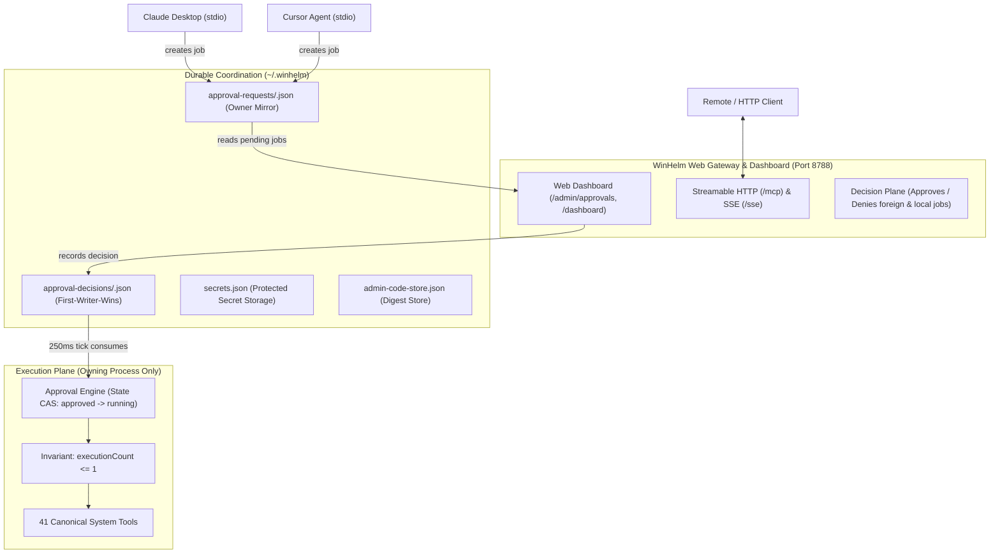

# WinHelm — Windows Native MCP Server

[](https://www.npmjs.com/package/winhelm-mcp)
[](https://opensource.org/licenses/MIT)
[](https://microsoft.com/windows)
[](https://nodejs.org/)
[]()
[](https://modelcontextprotocol.io/)

> **WinHelm MCP** — *The helm for your Windows workspace.*  
> A lightweight, production-grade Windows Native Model Context Protocol (MCP) server featuring a built-in Single-Process Web Gateway (Streamable HTTP `/mcp` + Server-Sent Events `/sse`), Real-Time Web Monitor & Approval Dashboard, 41 Canonical System Tools with Schema-v2 Governance & Dynamic Profiles, and MCP File Preview Resource.

[📖 Tools Reference](docs/TOOLS.md) • [⚙️ Tool Profiles](docs/PROFILES.md) • [🛡️ Security Architecture](docs/SECURITY.md) • [🎯 Threat Model](docs/THREAT_MODEL.md) • [📜 Terms of Use](TERMS_OF_USE.md) • [💡 Agent Examples](docs/EXAMPLES.md) • [📝 Changelog](CHANGELOG.md) • [🤝 Contributing](CONTRIBUTING.md)

---

## Product Status: v1.3 Release Candidate (RC Accepted)

This repository contains the accepted **v1.3 Release Candidate** implementation (`V1_3_RC_ACCEPTED` baseline). Technical RC blockers DEF-01 (Claude Desktop MSIX config discovery) and DEF-02 / DEF-02b (cross-process Dashboard approval routing and multi-instance admin code verification) have been resolved and verified across 580 automated tests and live client smokes.

> ℹ️ **Notice:** Production release, npm publication, and release tagging remain subject to human owner authorization during the release phase.

---

## Table of Contents

- [Overview](#overview)
- [Key Features](#key-features)
- [System Requirements](#system-requirements)
- [Architecture & Live Dashboard](#architecture--live-dashboard)
- [Quick Start](#quick-start)
  - [1. Setup & Configuration Wizard](#1-setup--configuration-wizard)
  - [2. Starting WinHelm](#2-starting-winhelm)
  - [3. Client Connection (Claude Desktop & Cursor)](#3-client-connection-claude-desktop--cursor)
  - [4. Dashboard & Human Approvals](#4-dashboard--human-approvals)
- [Configuration Modes: Legacy vs. Schema-v2](#configuration-modes-legacy-vs-schema-v2)
- [Security Profiles & Presets](#security-profiles--presets)
- [Canonical Tool Registry (41 Tools)](#canonical-tool-registry-41-tools)
- [Human Approval & Cross-Process Coordination](#human-approval--cross-process-coordination)
- [Client Configuration Reference](#client-configuration-reference)
  - [Claude Desktop (Classic & MSIX)](#1-claude-desktop-claude_desktop_configjson)
  - [Cursor IDE](#2-cursor-ide)
  - [ChatGPT & OpenAI MCP Tunnel](#3-chatgpt--openai-mcp-tunnel-tunnel-client)
  - [Remote & Tailscale Connection](#4-remote--tailscale-connection)
- [MCP Resources & Web Endpoints](#mcp-resources--web-endpoints)
- [Protected Secrets & Path Isolation](#protected-secrets--path-isolation)
- [Standalone Executable (`winhelm.exe`)](#standalone-executable-winhelmexe)
- [Known Limitations & Deferred Items](#known-limitations--deferred-items)
- [Documentation & Deep Dive](#documentation--deep-dive)
- [License](#license)

---

## Overview

**WinHelm** bridges the gap between AI assistants (Claude, Cursor, LibreChat, ChatGPT) and the Windows operating system. Unlike generic cross-platform servers, WinHelm is built from the ground up for Windows with:

- **Zero Gateway Overhead:** Native single-process Web Gateway supporting both modern Streamable HTTP (`/mcp`) and standard Server-Sent Events (`/sse`). No external proxy (`supergateway` or reverse proxy) required.
- **Safety & Recoverability:** Accidental deletions go to the **Windows Recycle Bin** instead of permanent destruction. Destructive system commands (`format-volume`, `rmdir /s /q c:\`) are strictly blocked.
- **Cross-Process Human Approval:** Multi-client stdio processes (Claude, Cursor) publish pending approval jobs to a shared durable mirror, allowing the local Web Dashboard to review and decide jobs while the owning process securely executes them.
- **First-class Windows Integrations:** NVIDIA/WMI GPU telemetry, Windows Services management, native UTF-8 PowerShell runner, no-shell command runner, and headless Microsoft Edge PDF compilation.

---

## Key Features

1. **All-in-One Gateway & Web Monitor:**
   - **Streamable HTTP:** `http://<HOST>:8788/mcp` (Modern MCP standard)
   - **SSE Stream & POST:** `http://<HOST>:8788/sse` and `/message`
   - **Web Monitor & Approval Dashboard:** `http://<HOST>:8788/` (Interactive metrics, pending approvals, sessions, drives, memory, GPU, and live audit logs)
   - **Interactive File Viewer:** `http://<HOST>:8788/preview?path=...` (Rich Markdown & code viewer with syntax formatting)
   - **Health Check:** `http://<HOST>:8788/health`
2. **Schema-v2 Governance & Human Approvals:**
   - Granular folder scoping (`read`, `readwrite`) preventing unauthorized filesystem traversal.
   - Terminal policies (`off`, `ask`, `full`) and risk classifications (R0 to R5).
   - Durable approval coordination across concurrent stdio instances with exactly-once execution guarantees (`executionCount <= 1`).
3. **High-Observability Logging & Secret Masking:**
   - Microsecond execution timings with ANSI color-coded tags (`[HTTP]`, `[TOOL-START]`, `[TOOL-DONE]`, `[SECURITY]`).
   - Automatically sanitizes Bearer tokens, API keys (`sk-***`, `ghp_***`), AWS credentials (`AKIA***`), JSON properties (`"authToken"`, `"password"`, `"x-api-key"`), and sensitive arguments.
4. **Background Daemon Task Engine:**
   - Execute long-running dev servers (`npm run dev`, `docker compose up`) as background tasks with detached PIDs, non-blocking logs streaming, and interactive stdin support.
5. **High-Performance Code Search (Ripgrep):**
   - Integrates `ripgrep` (`rg.exe`) for fast regex search with streaming pagination (`page`, `pageSize`, `hasMore`) to prevent context window overflow.
6. **Headless PDF Generation:**
   - Converts Markdown and HTML into clean PDF documents using pre-installed Microsoft Edge or Chrome without requiring heavy dependencies like Puppeteer.
7. **Tailscale & Remote Ready:**
   - Optionally bind to `0.0.0.0` or your Tailscale IP (`100.x.y.z`) for cross-device access. Default is `127.0.0.1` (loopback-only). Non-loopback binding requires Bearer Token verification and is guarded by a startup safety gate.

---

## System Requirements

| Component | Minimum Requirement | Recommended | Notes |
| :--- | :--- | :--- | :--- |
| **Operating System** | Windows 10 / 11 / Server 2019+ | Windows 11 (64-bit) | Native Win32 & PowerShell APIs |
| **Node.js** | Node.js >= 20.0.0 | Node.js 20+ LTS | Not required if using `dist/winhelm.exe` |
| **PowerShell** | Windows PowerShell 5.1 | PowerShell 7+ (pwsh) | Auto-detects pwsh with UTF-8 encoding |
| **PDF Engine** | Microsoft Edge | Pre-installed on Win 10/11 | Google Chrome is also auto-detected |
| **Search Engine** | Built-in recursive search | `ripgrep` (`rg.exe`) | Install via `winget install BurntSushi.ripgrep.MSVC` |
| **Privileges** | Standard User | Standard User | Administrator is only needed for `service:install` |

---

## Architecture & Live Dashboard

### System Architecture



---

## Quick Start

### 1. Setup & Configuration Wizard

Configure WinHelm using the interactive setup command or non-interactive CLI flags:

```powershell
# Interactive wizard (prompts for profile preset and allowed folders)
winhelm setup

# Non-interactive quick start with balanced profile and explicit workspace
winhelm setup --preset balanced --folder "D:\Workspace" --yes

# Dry-run preview without writing to disk
winhelm setup --preset safe --folder "C:\Projects" --dry-run

# Migrate an existing v1.2.1 configuration to schema-v2
winhelm setup --migrate-legacy --folder "D:\Workspace" --yes
```

### 2. Starting WinHelm

```powershell
# Start HTTP/SSE gateway and Web Dashboard on port 8788
npm start
# or:
winhelm

# Run directly in standard I/O mode for MCP clients
winhelm --stdio

# Run in read-only mode (blocks all mutations and shell execution)
winhelm --read-only
```

### 3. Client Connection (Claude Desktop & Cursor)

WinHelm provides automatic configuration discovery and connection helpers:

```powershell
# Preview configuration changes for Claude Desktop (dry-run)
winhelm connect claude --dry-run

# Apply configuration to Claude Desktop (creates backup, preserves other MCP servers)
winhelm connect claude --yes

# Apply configuration to Cursor IDE
winhelm connect cursor --yes

# Configure both Claude and Cursor at once
winhelm connect all --yes
```

- **Claude Desktop Support:** Resolves both classic (`%APPDATA%\Claude\claude_desktop_config.json`) and packaged/MSIX installations (`%LOCALAPPDATA%\Packages\Claude_*\LocalCache\Roaming\Claude\claude_desktop_config.json`) automatically.
- **Fail-Closed Safety:** If multiple ambiguous configuration files are discovered, the connector fails closed and requires an explicit `--config <path>` argument.
- **Secret Protection:** Client configuration files point to `winhelm --stdio` and never store raw auth tokens in client JSON.

### 4. Dashboard & Human Approvals

The WinHelm Web Dashboard at `http://127.0.0.1:8788/` allows monitoring system health and reviewing pending tool approval jobs:

1. Request a single-use local admin code from your interactive terminal:
   ```powershell
   winhelm admin-code
   ```
2. Open `http://127.0.0.1:8788/` in your browser and enter the admin code when prompted.
3. Review pending cross-process approvals initiated by Claude Desktop or Cursor, inspecting client identity, tool name, risk level, folder access, and parameter diffs.
4. Click **Approve** or **Deny**. The Dashboard records the decision, and the owning process executes the action.
5. Alternatively, inspect and decide jobs directly from the terminal:
   ```powershell
   winhelm jobs
   winhelm approve <jobId>
   winhelm deny <jobId>
   ```

---

## Configuration Modes: Legacy vs. Schema-v2

WinHelm supports two distinct configuration operating modes:

### 1. Legacy Mode (v1.2.1 Compatibility)
- Active when `winhelm.config.json` lacks a `schemaVersion` field.
- Preserves original v1.2.1 behavior: broad directory access governed solely by `allowedDirectories`, tool registration filtering by profile, and basic command blocklist.
- **Approval gating is inactive in legacy mode:** calls to approval-gated actions (such as terminating an external process not started by WinHelm) are not gated by human approval in legacy mode.
- Serves as a compatibility fallback for existing environments.

### 2. Schema-v2 Mode (`schemaVersion: 2`)
- Explicitly opted in via `winhelm setup` or `"schemaVersion": 2`.
- Enforces granular **Folder Permissions** (`read`, `readwrite`) with canonical path resolution.
- Enforces **Terminal Policies** (`off`, `ask`, `full`) and **Risk Classes** (R0 to R5).
- Enforces **Human Approval Lifecycle** with cross-process visibility and durable journals.
- Protects internal configuration, logs, journals, and secrets from AI tool modification even if broad folder permissions exist.

---

## Security Profiles & Presets

In schema-v2, profiles represent policy presets that configure folder permissions, terminal modes, and tool authorization policies:

| Profile | Folder Mode | Terminal Mode | Tool Policies | Target Use Case |
| :--- | :---: | :---: | :--- | :--- |
| **`safe`** | `read` (read-only) | `off` | R0 tools `auto`; all mutating, network, and desktop tools `off` | Code exploration, audits, small LLMs, zero mutation risk |
| **`balanced`** (Recommended) | `readwrite` | `ask` (approval required) | R0/R1 `auto`; R2/R3/R4 `ask` (approval); shell execution gated by terminal policy | Daily interactive engineering with human approval for elevated actions |
| **`power`** | `readwrite` | `full` (autonomous) | R0/R1/R2 `auto`; R3/R4 `ask`; terminal & command execution `auto` | Trusted automated agent pipelines requiring unrestricted shell workflows |

> ⚠️ **Note on Dangerous Mode:** An unrestricted `dangerous` mode is **not supported** in v1.3. It is explicitly reserved and deferred to v1.4.  
> 💡 **Legacy Presets:** Named presets (`minimal`, `core`, `dev`, `sysadmin`, `full`) remain supported in schema-v2 as compatibility presets that map to specific tool policy subsets.

---

## Canonical Tool Registry (41 Tools)

WinHelm defines **41 canonical tools** in its single source of truth registry (`src/tools/registry.ts`), validated via `npm run lint:tools`:

- **38 Legacy Tools:** Original tools across Terminal (6), Filesystem (12), Search/PDF/Preview (3), Desktop (5), System (9), and Network (3).
- **3 Schema-v2 Additions:**
  1. `command_run`: Direct command execution without shell wrapping, passing argument vectors cleanly.
  2. `winhelm_status`: Read-only snapshot of runtime permissions, profile, and server health.
  3. `winhelm_job_status`: Inspect status or retrieve results of an existing approval job by `jobId` or idempotency key.

### Conditional Runtime Exposure

- **In Legacy Mode:** 40 tools are registered (38 legacy tools + 2 recovery tools `winhelm_status` and `winhelm_job_status`). The `command_run` tool is schema-v2 only.
- **In Schema-v2 Mode:** All 41 canonical tools are registered on the MCP server. Permissions and approval gating are evaluated at call-time based on active folder rules and risk policy.

---

## Human Approval & Cross-Process Coordination

WinHelm v1.3 introduces a robust cross-process approval architecture (post DEF-02):

1. **Separation of Concerns:**
   - **Decision Plane:** The local Web Dashboard (`http://127.0.0.1:8788/`) or local CLI (`winhelm approve/deny`).
   - **Execution Plane:** The **owning WinHelm process** (e.g. the stdio process spawned by Claude Desktop or Cursor). The Dashboard never executes tool actions directly.
2. **Durable Per-Job Mirroring:**
   - On approval gating, the owning process durably persists the request to `~/.winhelm/approval-requests/<jobId>.json` along with sanitized display metadata (`clientInfo`, `risk`, `folderAccess`, `expiresAt`).
   - Decisions are recorded using atomic, first-writer-wins file creation (`~/.winhelm/approval-decisions/<jobId>.json`).
   - The owning process polls for decisions every 250 ms and applies them through its own engine.
3. **Atomic Exactly-Once Execution:**
   - Transition from `approved` to `running` uses a Compare-And-Swap (CAS) guard.
   - Guarantees `executionCount <= 1`: duplicate approves cannot cause duplicate execution.
   - Decisions submitted after job expiration (`expired`) or cancellation cannot execute.
4. **Fail-Closed Crash Recovery:**
   - If an owning process crashes while a job is running or pending, the recovered job state transitions to `unknown`. WinHelm never auto-replays ambiguous side effects.

---

## Client Configuration Reference

### 1. Claude Desktop (`claude_desktop_config.json`)

Use `winhelm connect claude --yes` for automatic configuration, or configure manually:

```json
{
  "mcpServers": {
    "winhelm": {
      "command": "node",
      "args": ["D:\\mcp\\winhelm-mcp\\dist\\index.js", "--stdio"]
    }
  }
}
```

- **Config Locations:**
  - Classic: `%APPDATA%\Claude\claude_desktop_config.json`
  - Packaged (MSIX): `%LOCALAPPDATA%\Packages\Claude_*\LocalCache\Roaming\Claude\claude_desktop_config.json`
- **Preservation:** WinHelm automatically merges into `mcpServers` and creates a timestamped backup (`.backup-<ISO>`) of the existing configuration.

### 2. Cursor IDE

Use `winhelm connect cursor --yes` for automatic configuration, or add in Cursor Settings (`Features` -> `MCP`):

- **Type:** `command`
- **Command:** `node D:\mcp\winhelm-mcp\dist\index.js --stdio`

### 3. ChatGPT & OpenAI MCP Tunnel (`tunnel-client`)

```yaml
config_version: 1
control_plane:
  base_url: "https://api.openai.com"
  tunnel_id: "your-tunnel-id-here"
  api_key: "env:CONTROL_PLANE_API_KEY"
mcp:
  commands:
    - channel: main
      command: 'node D:/mcp/winhelm-mcp/dist/index.js --stdio'
```

### 4. Remote & Tailscale Connection

```powershell
# Bind to 0.0.0.0 or Tailscale IP (Requires auth token)
winhelm --host 0.0.0.0 --auth my-secret-token
```

- **Endpoint:** `http://<TAILSCALE_IP>:8788/mcp`
- **Header:** `Authorization: Bearer my-secret-token`
- **Host Safety Gate:** WinHelm enforces a fail-closed startup check that terminates immediately if bound to a non-loopback host without an authentication token.

---

## MCP Resources & Web Endpoints

### MCP Resources
| URI | MIME Type | Description |
| :--- | :--- | :--- |
| `preview://file` | `text/html;profile=mcp-app` | Dynamic HTML preview for Markdown and source code files with syntax highlighting. |

### Gateway Endpoints
- **`/` & `/dashboard`** — Web Monitor & Approval Dashboard.
- **`/mcp`** — Streamable HTTP transport endpoint.
- **`/sse`** — Server-Sent Events transport endpoint.
- **`/message`** — POST endpoint for incoming JSON-RPC messages in SSE mode.
- **`/preview`** — Interactive browser file viewer (`/preview?path=D:\project\README.md`).
- **`/health`** — Health check probe (`{"status": "ok", "version": "1.2.1"}`).
- **`/admin/approvals`** — Admin approvals list and decision API.

---

## Protected Secrets & Path Isolation

1. **Protected Secret Storage:**
   - Authentication tokens and admin codes are stored in `~/.winhelm/secrets.json` and `admin-code-store.json`, protected by strict filesystem permissions.
   - Plaintext auth tokens are removed from `winhelm.config.json` upon migration/rotation.
2. **Protected Internal Paths:**
   - Internal directories (`~/.winhelm`, logs, journals, config files) are protected from modification by AI filesystem tools (`file_write`, `file_edit`, `file_delete_safe`), even if broad wildcard filesystem permissions exist.

---

## Standalone Executable (`winhelm.exe`)

Compile WinHelm into a standalone `.exe` (~2.6 MB) requiring no Node.js runtime:

```powershell
npm run build:exe
```

Run standalone executable:
```powershell
.\dist\winhelm.exe --stdio
```

---

## Known Limitations & Deferred Items

The following features are intentionally out of scope for v1.3 and deferred to v1.4:
- **Dangerous Mode:** Unrestricted mode is disabled/reserved.
- **Full Dashboard i18n:** Partial localization exists; comprehensive Thai/English translation is scheduled for v1.4.
- **System Tray Application (Tauri):** Scheduled for v1.4; v1.3 uses Web Dashboard and Windows Toast notifications.
- **`.mcpb` Bundle Packaging:** Scheduled for v1.4.

---

## Documentation & Deep Dive

- 📖 **[Tools Reference](docs/TOOLS.md)**: Full parameter specifications for all 41 tools.
- ⚙️ **[Tool Profiles](docs/PROFILES.md)**: Safe, Balanced, Power profiles and legacy preset mapping.
- 🛡️ **[Security Architecture](docs/SECURITY.md)**: Permissions model, approval lifecycle, and cross-process architecture.
- 🎯 **[Threat Model](docs/THREAT_MODEL.md)**: STRIDE analysis and trust boundary diagrams.
- 📜 **[Terms of Use](TERMS_OF_USE.md)**: User agreement and shared responsibility model.
- 📝 **[Changelog](CHANGELOG.md)**: Release notes and version history.
- 🤝 **[Contributing Guide](CONTRIBUTING.md)**: Development guidelines and test commands.

---

## License

This project is licensed under the [MIT License](LICENSE) — see the [LICENSE](LICENSE) file for details.
